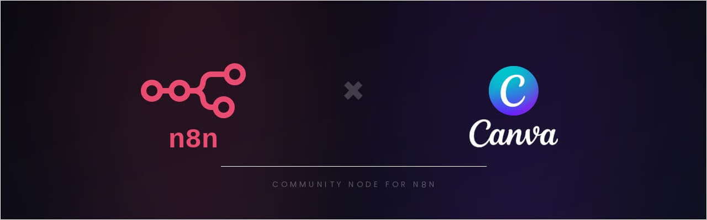
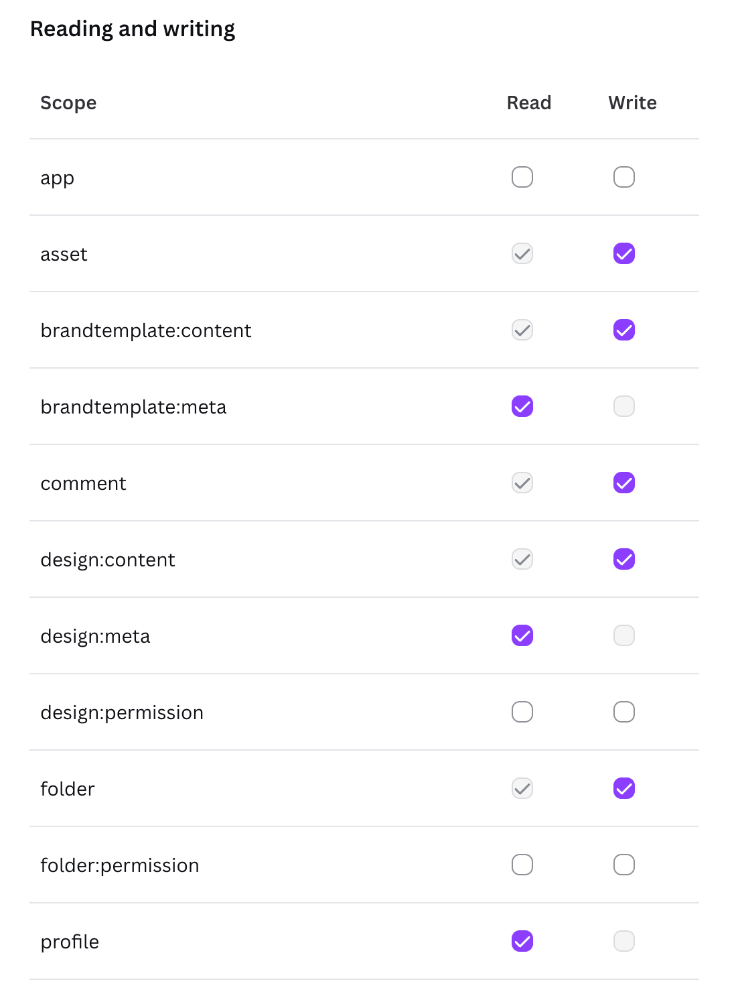

# n8n-nodes-canva



An n8n community node for connecting Canva to n8n using the [Canva Connect API](https://www.canva.dev/docs/connect/). Create and export designs, bulk-generate from brand templates, manage assets and folders, import external files, and connect Canva to the rest of your stack.

- [Installation](#installation)
- [Running n8n locally](#running-n8n-locally)
- [Credentials](#credentials)
- [Operations](#operations)
- [Usage notes](#usage-notes)
- [Resources](#resources)

## Installation

> This section is for people who already have an n8n instance running (cloud or self-hosted). If you want to test this node on your own machine first, see [Running n8n locally](#running-n8n-locally) below.

Follow the [installation guide](https://docs.n8n.io/integrations/community-nodes/installation/) in the n8n community nodes documentation.

## Running n8n locally

> This section is for developers who want to run and test this node locally.

**Prerequisites:** Node.js 24.15+, npm.

1. Install dependencies and start n8n in dev mode:

   ```bash
   npm install
   npm run dev
   ```

   This builds the node, links it to a local n8n instance, and starts n8n at [http://127.0.0.1:5678](http://127.0.0.1:5678) with hot reload enabled. The **Canva** node will appear in the node picker under _Community Nodes_.

2. Follow the [Credentials](#credentials) section below to connect your Canva account.

   > **Note:** When running locally, use `http://127.0.0.1:5678/rest/oauth2-credential/callback` as the redirect URI in the Canva Developer Portal. Canva does not accept `localhost` — you must use the IP address.

### Troubleshooting

#### `npm run dev` fails with `EACCES: permission denied, rename ...` inside `~/.npm/_cacache`

`npm run dev` starts n8n via `npx n8n@latest`, which downloads n8n through your machine's shared npm cache (`~/.npm`). If that cache contains files owned by another user — usually root, left behind by running npm with `sudo` at some point — the download fails with `EACCES`/`EEXIST` rename errors. Reclaim ownership of the cache and retry:

```bash
sudo chown -R $(id -u):$(id -g) ~/.npm
npm run dev
```

## Credentials

This node uses **OAuth2 with PKCE** to authenticate with Canva.

### 1. Create a Canva integration

Go to the [Canva Developer Portal](https://www.canva.com/developers/integrations/connect-api) and create a new private integration. After creation, the integration's settings page will automatically open.

- In the **Credentials** section, click on **Generate secret** to generate a new secret.
- Copy and paste both the **Client ID** and **Client secret** to a secure file.
- In the **Authentication** tab, add the **OAuth Redirect URL** shown in the n8n credential dialog to the **URL 1** field of the **Authorized redirects**:
  - **n8n Cloud:** `https://oauth.n8n.cloud/oauth2/callback`
  - **Self-hosted n8n:** `https://your-n8n-instance.com/rest/oauth2-credential/callback`
  - **Local n8n:** `http://127.0.0.1:5678/rest/oauth2-credential/callback`

- In the **Scopes** tab, enable the following scopes:

| Scope                                                                                    | Used by                                                                      |
| ---------------------------------------------------------------------------------------- | ---------------------------------------------------------------------------- |
| `asset:read` / `asset:write`                                                             | Asset, Generation, Image Transformation resources                            |
| `brandtemplate:content:read` / `brandtemplate:content:write` / `brandtemplate:meta:read` | Brand Template resource                                                      |
| `comment:read` / `comment:write`                                                         | Comment resource (Preview)                                                   |
| `design:content:read` / `design:content:write` / `design:meta:read`                      | Design, Autofill, Design Import, Export, Generation, Merge, Resize resources |
| `folder:read` / `folder:write`                                                           | Folder resource                                                              |
| `profile:read`                                                                           | User resource                                                                |

Your integration's **Scopes** settings should look like this:

<!-- markdownlint-disable-next-line MD033 -->


### 2. Add your integration's credentials to the Canva node in n8n

1. In n8n, open **Credentials → New → Canva OAuth2 API**.
2. Enter the **Client ID** and **Client secret** that you saved earlier.
3. Click **Connect my account** and complete the OAuth flow.

## Operations

### Asset

| Operation                   | Description                                                       |
| --------------------------- | ----------------------------------------------------------------- |
| Delete                      | Delete an asset                                                   |
| Get                         | Get metadata for an asset                                         |
| Update                      | Update an asset's name or tags                                    |
| Upload From URL _(Preview)_ | Upload an asset from a public URL and wait for completion (async) |

### Autofill

> 💎 The Autofill API can only be used on behalf of users on a Canva Pro plan or above.

| Operation | Description                                                                   |
| --------- | ----------------------------------------------------------------------------- |
| Create    | Populate a brand template with data and wait for the resulting design (async) |

### Brand Template

> 💎 The Brand Template APIs require a Canva plan with premium features (such as Canva Pro).

| Operation           | Description                                     |
| ------------------- | ----------------------------------------------- |
| Get                 | Get metadata for a brand template               |
| Get Dataset         | Get the autofill dataset for a brand template   |
| Get Many            | Get many brand templates accessible to the user |
| Publish _(Preview)_ | Publish a design as a brand template            |

### Comment _(Preview API)_

> ⚠️ All Comment operations use a Preview API that may have unannounced breaking changes and cannot be used in public integrations submitted for Canva review.

| Operation     | Description                                |
| ------------- | ------------------------------------------ |
| Create Reply  | Reply to a comment thread on a design      |
| Create Thread | Create a new comment thread on a design    |
| Get Reply     | Get a specific reply from a comment thread |
| Get Thread    | Get metadata for a comment thread          |
| List Replies  | List all replies in a comment thread       |

### Design

| Operation               | Description                                   |
| ----------------------- | --------------------------------------------- |
| Create                  | Create a new design                           |
| Get                     | Get metadata for a design                     |
| Get Dataset _(Preview)_ | Get the autofill dataset for a design         |
| Get Export Formats      | Get the available export formats for a design |
| Get Many                | Get many designs from the user's projects     |
| Get Pages _(Preview)_   | Get metadata for pages in a design            |

### Design Import

| Operation                     | Description                                                                                        |
| ----------------------------- | -------------------------------------------------------------------------------------------------- |
| Import From Image _(Preview)_ | Turn a flat image asset into an editable design using Magic Layers and wait for completion (async) |
| Import From URL               | Import an external file (e.g. PPTX, PDF) into Canva from a URL and wait for completion (async)     |

### Export

| Operation     | Description                                                            |
| ------------- | ---------------------------------------------------------------------- |
| Export Design | Export a design to a file format and wait for the download URL (async) |

### Folder

| Operation  | Description                                           |
| ---------- | ----------------------------------------------------- |
| Create     | Create a new folder                                   |
| Delete     | Delete a folder                                       |
| Get        | Get metadata for a folder                             |
| List Items | List items inside a folder                            |
| Move Item  | Move a design, asset, or folder to a different folder |
| Update     | Rename a folder                                       |

### Generation _(Preview API)_

> ⚠️ All Generation operations use a Preview API that may have unannounced breaking changes and cannot be used in public integrations submitted for Canva review.

| Operation       | Description                                                                                                              |
| --------------- | ------------------------------------------------------------------------------------------------------------------------ |
| Generate Design | Generate a presentation or Canva doc from a brief, optionally following a slide outline, and wait for completion (async) |
| Generate Image  | Generate an image from a prompt, optionally saving it to the user's Uploads, and wait for completion (async)             |

### Image Transformation _(Preview API)_

> ⚠️ All Image Transformation operations use a Preview API that may have unannounced breaking changes and cannot be used in public integrations submitted for Canva review.

> 💎 Background removal requires a Canva plan with premium features (such as Canva Pro).

| Operation         | Description                                                                          |
| ----------------- | ------------------------------------------------------------------------------------ |
| Remove Background | Remove the background from an image asset and save the result as a new asset (async) |

### Merge _(Preview API)_

> ⚠️ All Merge operations use a Preview API that may have unannounced breaking changes and cannot be used in public integrations submitted for Canva review.

| Operation        | Description                                                                         |
| ---------------- | ----------------------------------------------------------------------------------- |
| Create Merge Job | Merge design pages by applying page operations to create or modify a design (async) |

### Resize

> 💎 The Resize API requires a Canva plan with premium features (such as Canva Pro). Users on the Canva Free plan have access to a limited trial.

| Operation         | Description                                                                       |
| ----------------- | --------------------------------------------------------------------------------- |
| Create Resize Job | Create a resized copy of a design in new dimensions or a different format (async) |

### User

| Operation        | Description                                                    |
| ---------------- | -------------------------------------------------------------- |
| Get Capabilities | Get the API capabilities available to the current user account |
| Get Me           | Get the User ID and Team ID of the authenticated user          |
| Get Profile      | Get the display name of the authenticated user                 |

## Usage notes

### Async operations

Several operations — **Asset Upload From URL**, **Autofill**, **Design Import**, **Export**, **Generation**, **Image Transformation**, **Merge**, and **Resize** — create background jobs in Canva. This node automatically polls for completion and returns the final result once the job succeeds.

You can tune polling behaviour with two optional parameters available on each async operation:

- **Poll Interval** (default 2–3 s depending on the operation) — how often to check for job completion
- **Max Wait** (default 60–300 s depending on the operation) — maximum time to wait before throwing a timeout error

If a job fails, the node throws an error with the Canva error details.

### Preview APIs

Operations marked _(Preview)_ use endpoints that are still in preview on the Canva platform. They may change without notice and **cannot be used in integrations submitted to Canva's public integration review**. Use them only for internal or development workflows.

### AI credits

**Design Import → Import From Image**, **Generation → Generate Design** and **Generate Image**, and **Image Transformation → Remove Background** use the user's Canva AI credits each time they start a job (checking on a running job doesn't). If the user is out of AI credits, the node fails immediately with a `credit_quota_exceeded` error instead of retrying.

### Moving items

The **Folder → Move Item** operation accepts any item ID (design, asset, or folder). To move an item to the top-level Projects folder, use `root` as the **To Folder ID**.

### Magic Layers

**Design Import → Import From Image** turns a flat image (such as a poster, flyer, or social graphic) into a Canva design where each element is a separate, editable layer. It takes the ID of an image asset that's already in the user's Canva account, so upload the image first with **Asset → Upload From URL** and pass the resulting `job.asset.id`.

Magic Layers must be allowed in the user's team permissions. **User → Get Capabilities** returns `image_to_design_imports` when the user can use it.

### Background removal

**Image Transformation → Remove Background** saves the cut-out image as a new asset and leaves the original untouched. Like Magic Layers, it takes the ID of an image asset that has finished uploading. The new asset's ID is at `job.result.asset.id`, ready to use in **Design → Create** or as an image field in **Autofill → Create**.

It requires a Canva plan with premium features. **User → Get Capabilities** returns `background_removal` when the user can use it. If Canva can't find a subject to keep, the job fails and the node reports Canva's reason.

### Design generation

**Generation → Generate Design** creates a presentation or Canva doc from a written **Brief**. The more the brief says about the subject, audience, required wording, tone, and look, the closer the result will be.

For presentations, an optional **Outline** sets the slides to generate, in the same format as the Canva API: a `sections` array of up to 100 slides, each with a `title` and an optional `description` and `points` (up to 50). Leave `sections` empty (the default, `{"sections": []}`) to let Canva plan the slides. If an earlier node or an AI agent produces just the list of slides, wrap it with an expression such as `{{ { "sections": $json.slides } }}`.

The new design opens from `job.result.design.urls.edit_url`, which is valid for 30 days and only works for the connected user. Design generation depends on the user's eligibility and team permissions; **User → Get Capabilities** returns `design_generation` when the user can use it. If the brief fails Canva's content-safety checks, the job fails and the node reports Canva's reason.

### Image generation

**Generation → Generate Image** creates one image from a text **Prompt**, in a square, landscape, or portrait shape. Leave **Model** on **Auto** to let Canva pick the best model and fall back to another if one is unavailable. Picking a specific model makes the job fail when that model can't serve the request.

By default, the image is also saved to the user's Canva Uploads, and its asset ID at `job.result.image.asset.id` works straight away in **Design → Create** or as an image field in **Autofill → Create**. Turn off **Save to Uploads** to get only the download URL at `job.result.image.url`, which is valid for 24 hours. To pass the file itself to another node, download that URL with an **HTTP Request** node. If the prompt fails Canva's safety checks, the job fails and the node reports Canva's reason.

### Autofill dataset format

The **Autofill → Create** operation requires a `data` object whose keys must match the dataset fields returned by **Brand Template → Get Dataset**. Use the Get Dataset operation first to discover the correct field names.

## Resources

- [Ready-to-import example workflows](./examples/)
- [n8n community nodes documentation](https://docs.n8n.io/integrations/community-nodes/)
- [Canva Connect API reference](https://www.canva.dev/docs/connect/api-reference/)
- [Canva Developer Portal](https://www.canva.com/developers)
- [Canva Developer Documentation](https://www.canva.dev/)
